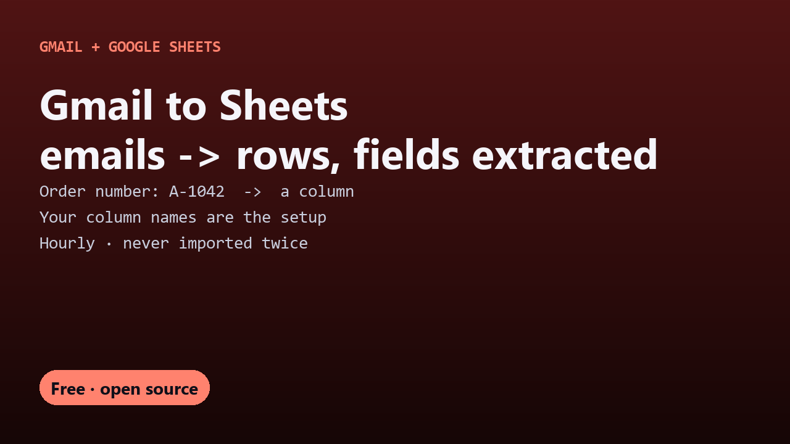

# Free Gmail to Sheets

Extract data from Gmail into Google Sheets automatically, one row per email, with fields like order number and total pulled from the body. One free Apps Script file, no parser subscription.

## Guides

- [How to extract data from Gmail into Google Sheets automatically](extract-data-from-gmail-to-google-sheets.html)

## Get it

The script and full instructions are on GitHub: [DecodedXR/gmail-to-sheets](https://github.com/DecodedXR/gmail-to-sheets). It's MIT licensed and free.
